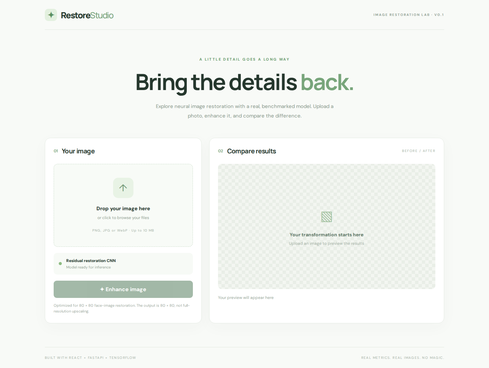

# Restore Studio

**An interactive image-restoration experiment.** Upload a photo, explore the results of a trained neural network, and compare images with a draggable before/after slider.

Built with **React · TypeScript · FastAPI · TensorFlow**



### See the difference


The app uses a residual convolutional neural network (CNN) to restore deliberately degraded face images. It includes image upload, a comparison slider, and PNG downloads.

### Behind the project

Originally a computer-vision learning exercise, this project has grown into a full-stack application with a new residual model, automated tests, and reproducible image-quality benchmarks.

On **120 held-out LFW face images**, the model scored **36.54 dB PSNR** versus **34.31 dB** for bicubic interpolation. [See the evaluation workflow](.github/workflows/real-image-evaluation.yml).

> **Note:** This is an experimental **80 × 80 face-restoration** demo, not a general-purpose high-resolution photo upscaler. Model weights must be trained locally before using inference.

### Run it yourself

You'll need Python 3.11, Node.js 20+, and trained model weights. See the [backend setup guide](api/README.md) for installation and model setup. Then start the frontend with:

```bash
cd frontend
npm install
npm run dev
```

### Credits

This project began around 2020 as a computer vision learning exercise inspired by a Coursera course and an online tutorial. I no longer have the original references, but wanted to acknowledge those early learning resources. The project has since been substantially expanded with a new model architecture, benchmarking, and an interactive web application.
